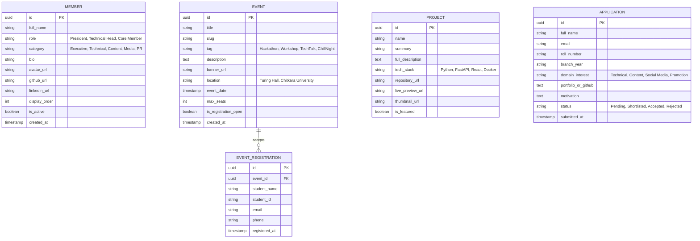

# 🌐 Code2Chill (C2C) — Complete Website Master Knowledge Base & Architecture

> **Official Tech Club Portal Specification**  
> **Institution**: Chitkara University (Office of Student Life)  
> **Repository**: `Code2Chill`  
> **Target Aesthetic Standard**: High-End Minimalist Dark Tech (`noddal.xyz` & `ksenpanchenko.com`)  
> **Evaluation Goal**: Technical Viva Distinction & Project Selection  

---

## Table of Contents
1. [Executive Summary & Club Identity](#1-executive-summary--club-identity)
2. [Visual Assets & Brand Design System](#2-visual-assets--brand-design-system)
3. [Verified Team Hierarchy & Leadership Roster](#3-verified-team-hierarchy--leadership-roster)
4. [Comparative Analysis: Anti-Patterns vs Design Benchmarks](#4-comparative-analysis-anti-patterns-vs-design-benchmarks)
5. [Independent Data Reconnaissance Strategy](#5-independent-data-reconnaissance-strategy)
6. [Full-Stack Technology Stack & Technical Rationale](#6-full-stack-technology-stack--technical-rationale)
7. [System Architecture & Request Lifecycle](#7-system-architecture--request-lifecycle)
8. [Database Schema & Relational Models (ERD)](#8-database-schema--relational-models-erd)
9. [Complete 7-Phase Implementation Roadmap](#9-complete-7-phase-implementation-roadmap)
10. [Phase 1: Granular Step-by-Step Breakdown](#10-phase-1-granular-step-by-step-breakdown)
11. [Technical Viva Defense Cheat Sheet](#11-technical-viva-defense-cheat-sheet)

---

## 1. Executive Summary & Club Identity

### 1.1 Mission & Philosophy
* **Club Name**: **Code2Chill (C2C)**
* **Parent Institution**: Chitkara University, Punjab (Registered under the Office of Student Life / Student Affairs).
* **Core Philosophy**: Bridging intense, industry-grade software engineering with a collaborative, unpretentious, "chill" community culture. C2C eliminates the toxic hustle culture often associated with collegiate coding societies, prioritizing peer-to-peer open-source building, hackathons, and stress-free technical mastery.
* **Core Activities**:
  - 24-hour campus hackathons and coding sprints.
  - Practical engineering bootcamps (Python, Web3, Cloud, System Design, Git workflows).
  - Open-source campus utility engineering (building real applications for university students).
  - Peer mentorship, technical interview preparation, and placement coaching.

---

## 2. Visual Assets & Brand Design System

### 2.1 Logo Analysis & Token Assets
Located directly in the root repository:
1. `Code2Chill.png` — Dark obsidian background banner with neon gradient accents.
2. `Code2Chill_transparent.png` — High-resolution transparent PNG optimized for navigation bars, responsive headers, and favicons.

* **Monogram Breakdown**:
  - Central glyph `C2C`: The first `C` encloses `< / >` (syntax/tags), the second `C` encloses `{ }` (code blocks/data).
  - The numeral `2` forms a sweeping crescent curve on top of which sits the silhouette of a developer with a laptop.
  - Subtitle: `CODE 2 CHILL` with an aerospace-grade letter-spaced `— CLUB —` tagline.

### 2.2 Color Tokens & UI Palette
* **Obsidian Void (Background)**: `#07090E` (primary surface), `#0E1421` (elevated glass card surface).
* **Electric Cyan (Primary Accent)**: `#38BDF8` (highlights, active states, key interactive badges).
* **Deep Cyber Blue (Secondary Accent)**: `#2563EB` (gradient mesh, button fills, shadows).
* **Border Radiance**: `rgba(255, 255, 255, 0.08)` baseline; `rgba(56, 189, 248, 0.35)` on hover.
* **Typography**:
  - Headings & Interface: `Plus Jakarta Sans` or `Geist Sans` (clean geometric humanist sans-serif).
  - Code, Shells & Badges: `JetBrains Mono` (developer-centric monospace).

---

## 3. Verified Team Hierarchy & Leadership Roster

Verified from the official Chitkara University Office of Student Life club records:

| No. | Name | Official Designation | Domain / Department | Core Focus Area |
|:---:|:---|:---|:---|:---|
| **1** | **Lakshay Kalra** | **Club Leader / President** | Executive | Strategic roadmap, administrative liaison, club vision |
| **2** | **Jiya Arora** | **Club Vice-President** | Executive / Core Member | Operations, inter-domain synergy, execution |
| **3** | **Samanyu Thakur** | **Technical Head** | Technical Domain | Engineering roadmaps, hackathon challenges, stack choice |
| **4** | **Bhupinder Singh** | **Technical Head** | Technical Domain | Architecture reviews, mentorship, open-source repos |
| **5** | **Tamanna Kakkar** | **Content Head** | Editorial & Content | Event narratives, technical documentation, newsletters |
| **6** | **Ayush Sharma** | **Content Head** | Editorial & Content | Curriculum drafting, workshop slides, social copy |
| **7** | **Jashan Bhalla** | **Social Media Head** | Creative & Media | Instagram content strategy, brand engagement, reels |
| **8** | **Muskan Dhanda** | **Promotion Head** | Public Relations (PR) | Campus campaigns, recruitment drives, sponsorships |
| **9** | **Divyana Garg** | **Core Member** | Operations | Event logistics, attendee hospitality, floor coordination |
| **10**| **Hunar Mehndiratta**| **Core Member** | Tech & Logistics | Technical workshops, candidate screening, moderation |

---

## 4. Comparative Analysis: Anti-Patterns vs Design Benchmarks

### 4.1 What NOT to Do (`dgitsquad.vercel.app`)
* **Uncalibrated Typography**: Default browser line heights, generic system fonts, no typographic hierarchy.
* **Clashing Flat Color Blocks**: Highly saturated neon colors pasted onto harsh backgrounds without depth or ambient gradients.
* **Boxy, Static Cards**: Rigid layout reminiscent of a 2012 basic template or a rushed Linktree clone.
* **Zero Micro-Interactions**: Flat buttons, no hover physics, no active feedback.
* **Hardcoded Static Markup**: Zero dynamic database backend; modifying any text requires redeploying the site.

### 4.2 What to Emulate (`noddal.xyz` & `ksenpanchenko.com`)
* **Atmospheric Depth**: Dark obsidian palette with subtle radial blur gradients (`backdrop-blur-xl`).
* **Bento Grid Architecture**: Asymmetric modular cards displaying varied density (metrics, countdowns, Spotify/Lo-Fi music cards, CLI terminals).
* **Kinetic Micro-Interactions**: 1px subtle glowing borders, spring hover physics, interactive terminal widgets, animated count-up numbers.
* **Dynamic Full-Stack Integration**: Every piece of data (events, heads, projects, applications) is served dynamically via Python API endpoints.

---

## 5. Independent Data Reconnaissance Strategy

To gather club details without asking leads directly:

1. **Instagram (`@code2chill`)**:
   - Check **Highlights**: *Events*, *Recruitment*, *Hackathons*, *Team*.
   - Review **Post Captions**: Reveal exact dates, campus venues (*Turing Hall*, *Exploratorium*, *Picasso Lab*), sponsors (*Devfolio*, *GitHub*).
   - Review **Tagged Photos**: High-res photos of students participating in past club events.
2. **LinkedIn OSINT**:
   - Query: `"Lakshay Kalra" "Chitkara"`, `"Jiya Arora" "Chitkara"`, `"Samanyu Thakur"`, `"Bhupinder Singh"`.
   - Extract professional headshots, GitHub profiles, and specific tech skills.
3. **Chitkara Portal (`chitkarau.life/clubs/code2chill`)**:
   - Official club descriptions, annual event logs, and faculty coordinator records.
4. **Automated Seeder Pattern (`seed_data.py`)**:
   - Seed the database with high-realism data for all 10 heads, verified events, and mock campus projects so the entire full-stack app is immediately testable and functional.

---

## 6. Full-Stack Technology Stack & Technical Rationale

| Layer | Selected Tech | Technical Justification for Viva |
|:---|:---|:---|
| **Backend Engine** | **FastAPI (Python 3.11+ ASGI)** | Runs on the Starlette ASGI framework with non-blocking `asyncio` event loops. Far higher throughput than synchronous Flask (WSGI), without the monolithic bloat of Django. |
| **Validation Layer** | **Pydantic v2** | Core rewritten in Rust (`pydantic-core`). Delivers strict runtime type enforcement, automated `422 Unprocessable Entity` payloads, and OpenAPI documentation. |
| **ORM & Data** | **SQLAlchemy 2.0 (AsyncIO)** | Uses modern `AsyncSession` pattern with `aiosqlite` (dev) / `asyncpg` (prod). Clean separation of concerns with typed SQL expressions. |
| **Migrations** | **Alembic** | Version-controlled schema migrations preventing data loss during model updates. |
| **Security & Auth** | **Passlib (Bcrypt) + PyJWT** | Irreversible password hashing with 12 salt rounds; stateless JWT tokens with HS256 signatures for admin portal routes. |
| **Rate Limiter** | **SlowAPI** | In-memory token bucket rate limiting on public registration and recruitment routes to block spam. |
| **Frontend Framework** | **Vite + React 18 + Tailwind CSS** | Blazing-fast HMR, component modularity, atomic utility-first styling with dark theme support. |

---

## 7. System Architecture & Request Lifecycle

```
CLIENT (Browser)                 BACKEND GATEWAY (FastAPI)           PERSISTENCE
┌──────────────────┐            ┌──────────────────────────┐       ┌─────────────┐
│ React SPA        │            │ SlowAPI (Rate Limiter)   │       │ SQLite/     │
│ - Bento Grid     │ HTTP JSON  │           │              │       │ PostgreSQL  │
│ - Dynamic Events │───────────▶│ Pydantic v2 Validation   │       │             │
│ - Team Showcase  │◀───────────│           │              │       │             │
│ - Join Form      │            │ FastAPI APIRouter        │       │             │
└──────────────────┘            │           │              │       │             │
                                │ Depends(get_db) Session  │       │             │
                                │           │              │ Async │             │
                                │ SQLAlchemy 2.0 Async ORM ├──────▶│ Rows / Data │
                                └──────────────────────────┘       └─────────────┘
```

---

## 8. Database Schema & Relational Models (ERD)



---

## 9. Complete 7-Phase Implementation Roadmap

* **Phase 1: Environment & Project Scaffolding** (Virtual env, backend skeleton, Vite frontend, asset linking).
* **Phase 2: Database Modeling & Data Seeding** (SQLAlchemy models, Alembic, dynamic `seed_data.py`).
* **Phase 3: Backend API & Security Layer** (REST endpoints, JWT admin auth, SlowAPI rate limiting, OpenAPI docs).
* **Phase 4: Modern Frontend Development** (Dark aesthetic, Bento Grid, live Terminal widget, team cards, RSVP modal).
* **Phase 5: Micro-Interactions & Animation Stack** (Hover glows, hardware-accelerated transitions upon confirmation).
* **Phase 6: Professional Documentation & Viva Defense** (Formal SRS.md, Architecture.md, Viva Q&A cheat sheet).
* **Phase 7: Deployment & Production Readiness** (Docker, environment secrets, automated testing).

---

## 10. Phase 1: Granular Step-by-Step Breakdown

Phase 1 establishes the rock-solid foundation for both the Python ASGI engine and the modern client application.

```
PHASE 1 EXECUTION TIMELINE:
[Step 1.1] Workspace & Directory Layout
    └─▶ [Step 1.2] Python Virtual Environment & Backend Dependencies
            └─▶ [Step 1.3] FastAPI Baseline Application & Healthcheck Route
                    └─▶ [Step 1.4] Vite + React + Tailwind CSS Setup
                            └─▶ [Step 1.5] Brand Assets & Typography Integration
                                    └─▶ [Step 1.6] End-to-End Orchestration & Verification
```

### Step 1.1: Root Workspace & Directory Layout
* Initialize the root configuration: `.gitignore` (ignoring `.venv`, `node_modules`, `__pycache__`, `.env`), `.env.example`, and directory structure:
  ```
  Code2Chill/
  ├── backend/
  │   └── app/
  ├── frontend/
  ├── docs/
  └── assets/
  ```

### Step 1.2: Python Virtual Environment & Dependencies
* Create an isolated Python 3.11+ virtual environment (`python -m venv .venv`).
* Create `backend/requirements.txt` with locked dependencies:
  - `fastapi==0.110.0`
  - `uvicorn[standard]==0.28.0`
  - `sqlalchemy[asyncio]==2.0.28`
  - `aiosqlite==0.20.0`
  - `pydantic==2.6.4`
  - `pydantic-settings==2.2.1`
  - `slowapi==0.1.9`
  - `python-jose[cryptography]==3.3.0`
  - `passlib[bcrypt]==1.7.4`
  - `httpx==0.27.0` (for async tests)
  - `pytest==8.1.1`

### Step 1.3: FastAPI Baseline Application & Healthcheck
* Implement `backend/app/main.py`:
  - Initialize `FastAPI(title="Code2Chill API", version="1.0.0")`.
  - Configure `CORSMiddleware` (allowing frontend `http://localhost:5173`).
  - Create `GET /api/v1/health` returning system status, timestamp, and API version.
  - Test and verify auto-generated Swagger UI at `http://localhost:8000/docs`.

### Step 1.4: Frontend Project Scaffolding
* Initialize Vite with React and TypeScript/JavaScript in `frontend/`.
* Configure Tailwind CSS v3 (`tailwind.config.js`) with:
  - Custom dark theme colors: Obsidian `#07090E`, Card `#0E1421`, Cyan `#38BDF8`.
  - Custom font family declarations (`Plus Jakarta Sans`, `JetBrains Mono`).

### Step 1.5: Static Asset & Typography Pipeline
* Move [Code2Chill_transparent.png](file:///d:/Coding/C2C/Code2Chill/Code2Chill_transparent.png) and [Code2Chill.png](file:///d:/Coding/C2C/Code2Chill/Code2Chill.png) into `frontend/public/` for clean client referencing.
* Add Google Fonts preload links in `frontend/index.html`.

### Step 1.6: End-to-End Orchestration & Connection Test
* Run backend via `uvicorn app.main:app --reload --port 8000`.
* Run frontend via `npm run dev -- --port 5173`.
* Verify that the frontend fetches `/api/v1/health` successfully across the local CORS boundary.

---

## 11. Technical Viva Defense Cheat Sheet

### Q1: Why FastAPI instead of Flask or Django?
> *"Django is a monolithic framework designed around synchronous WSGI, making it overly heavy for microservice-style APIs. Flask, while lightweight, lacks native asynchronous event loops and built-in type validation. FastAPI is built on ASGI (Asynchronous Server Gateway Interface), leveraging Python's `asyncio` to handle thousands of concurrent non-blocking I/O connections. It also uses Pydantic v2 for runtime serialization and generates OpenAPI documentation automatically."*

### Q2: How do you guarantee the website is dynamic and not static?
> *"All entities—including the roster of core heads, upcoming coding events, registrations, and project portfolios—are persisted in an asynchronous relational database via SQLAlchemy 2.0. The frontend makes asynchronous REST calls to parameterized `/api/v1/*` endpoints. If an event is updated in the database or recruitment is toggled off, the client interface reacts dynamically without requiring a rebuild or redeployment."*

### Q3: How do you secure public endpoints against abuse?
> *"We implement rate-limiting via SlowAPI on public submission routes (`/api/v1/recruit` and event registrations) to mitigate denial-of-service and bot spam. For the admin lead dashboard, passwords are hashed with `bcrypt` (12 salt rounds), and protected routes require valid `HS256` signed JWT bearer tokens with short expiry windows."*

### Q4: How is your database migration strategy structured?
> *"We utilize Alembic. Every change to declarative models in SQLAlchemy generates an immutable, revision-controlled migration script in `alembic/versions/`. This ensures zero data loss when deploying between SQLite local development and cloud production PostgreSQL databases."*
