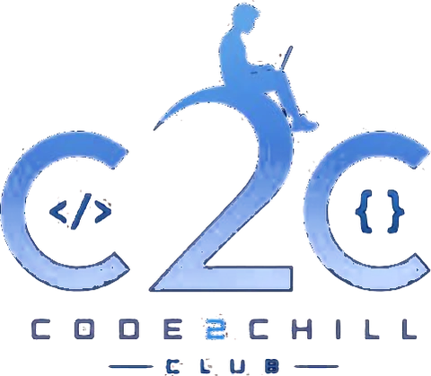

<p align="center">
  
</p>

<h1 align="center">Code2Chill (C2C)</h1>

<p align="center">
  <strong>Where Serious Code Meets Chill Vibes</strong><br />
  Official Student Technical Club &bull; Chitkara University
</p>

<p align="center">
  
  
  
  
  
  
  
</p>

---

## 🎧 Overview

**Code2Chill (C2C)** is an active, student-led technical community under the **Office of Student Life at Chitkara University**. We bridge intense, industry-grade software engineering with an inclusive, relaxed community culture. 

No toxic hustle culture—just curious builders collaborating through hands-on hackathons, open-source projects, and peer-to-peer mentorship.

This repository houses the **dynamic Python full-stack club portal**, featuring an asynchronous FastAPI REST backend, a persistent relational PostgreSQL database, and an editorial, high-performance React client interface.

---

Home previews the next event or latest archive entry, a student project, and two members from the published roster. Browse Events, Projects, and Team in the main navigation. About, Join, and Contact provide club information and official links. Admins and editors can save, preview and publish events from the dashboard. The status page checks PostgreSQL through FastAPI. [Staff account setup](docs/DEVELOPMENT.md#create-a-staff-account) · [Publish an event](docs/DEVELOPMENT.md#publish-an-event)

## ✨ Planned club features

* **Dynamic Event Hub**: Real-time discovery for upcoming hackathons, coding sprints, and historical archives (*DOMination*, *Byte The Vibe*).
* **Official University Handoff**: Pragmatic registration flow integrating seamlessly with Chitkara University's official student portal.
* **Open Source Showcase**: Highlights real, member-built projects (such as *NEXUS* emotion detection and *ChronoAtlas*).
* **Verified Team Hierarchy**: Dynamic roster management for club leadership and domain heads.

The scaffold uses the campus event programme design, local Barlow Condensed and DM Sans fonts, and visible keyboard focus rings.

---

## 🏛️ System Architecture

```text
React /status → GET /api/health → FastAPI → SQLAlchemy + psycopg → PostgreSQL 17
                                                  SELECT 1
Healthy response      HTTP 200     {"status":"ok"}
Database unavailable  HTTP 503     {"detail":"Database unavailable"}
```

---

## 📁 Repository Structure

```text
Code2Chill/
├── backend/                  # Python 3.13+ FastAPI ASGI application
│   ├── app/                  # Application core, database engine, and routers
│   ├── tests/                # Automated pytest test suites
│   ├── compose.yaml          # Local PostgreSQL 17 container orchestration
│   ├── pyproject.toml        # uv / PEP 621 dependency management
│   └── uv.lock               # Deterministic Python dependency lock
├── frontend/                 # React 19 + JavaScript + Vite + Tailwind CSS
│   ├── src/                  # Component tree, router, and page styles
│   ├── package.json          # npm scripts and dependencies
│   ├── vite.config.js        # Vite build configuration
│   └── biome.json            # Biome formatting and linting configuration
├── docs/                     # Living documentation, design system & planning
│   ├── BUILD_GUIDE.md        # Living build guide & technical viva preparation
│   ├── DEVELOPMENT.md        # Local environment & developer setup guide
│   ├── CONTENT_REGISTER.md   # Verified club facts, events, and asset inventory
│   ├── LAUNCH_SCOPE.md       # Scope boundaries, registration, and recruitment rules
│   ├── PAGES_AND_JOURNEYS.md # 9 route specs, user flows, and error resilience
│   ├── VISUAL_IDENTITY.md    # Design system, tokens, and logo placement matrix
│   ├── WIREFRAMES.md         # Responsive desktop and mobile wireframes
│   ├── HANDOVER.md           # Production deployment & operations manual
│   ├── TECHNICAL_EXPLANATION.md # Architecture & viva defense guide
│   ├── DEMONSTRATION.md      # Live demonstration script & interface walkthrough
│   ├── OWNERSHIP.md          # Platform ownership, governance & maintenance charter
│   ├── AGENTS.md             # Contributor instructions and documentation policy
│   ├── planning/             # Historical planning specifications and blueprints
│   └── design/               # Standalone HTML page previews & offline web assets
│       ├── brand/            # Responsive WebP marks, icons, and favicon
│       ├── fonts/            # Self-hosted Barlow Condensed & DM Sans
│       ├── index.html        # Verified Home design preview
│       └── domination.html   # Verified Event Detail design preview
├── Expriments/               # Isolated prototype experiments
├── .gitignore                # Environment and dependency exclusion rules
├── README.md                 # Project entry point
└── WEBSITE_ROADMAP.md        # 11-phase implementation roadmap
```

---

## 🛠️ Local Development & Setup

For step-by-step local developer setup, Docker container commands, and backend/frontend startup instructions, please refer to the **[Local Development Guide](docs/DEVELOPMENT.md)**.

---

## 📖 Living Documentation Suite

The project enforces continuous living documentation updated across all development phases:

| Document | Focus & Purpose |
| :--- | :--- |
| **[Implementation Roadmap](WEBSITE_ROADMAP.md)** | 11-phase master execution plan with strict completion criteria. |
| **[Living Build Guide](docs/BUILD_GUIDE.md)** | Chronological task history (`TASK-001`+), verification logs, and viva defense answers. |
| **[Technical Architecture & Viva](docs/TECHNICAL_EXPLANATION.md)** | Architecture breakdown, request lifecycles, validation, auth, migrations, and viva Q&A. |
| **[Demonstration & Walkthrough](docs/DEMONSTRATION.md)** | 8-step live walkthrough script, talking points, and polished interface screenshots. |
| **[Handover & Operations](docs/HANDOVER.md)** | Production deployment, rollback procedures, admin onboarding, and operational checklists. |
| **[Ownership & Governance](docs/OWNERSHIP.md)** | Governance charter, credential security, maintenance calendar, and escalation matrix. |
| **[Local Development Guide](docs/DEVELOPMENT.md)** | Prerequisites, local PostgreSQL container, FastAPI startup, and Vite client execution. |
| **[Content Register](docs/CONTENT_REGISTER.md)** | Verified club facts, leadership roster, past events, and media provenance. |
| **[Launch Scope & Rules](docs/LAUNCH_SCOPE.md)** | MVP feature boundaries, university registration handoff, and recruitment rules. |
| **[Pages & User Journeys](docs/PAGES_AND_JOURNEYS.md)** | Route specifications, interaction flows, and system resilience states. |
| **[Visual Identity System](docs/VISUAL_IDENTITY.md)** | Tokens, typography scales, contrast checks, and brand export rules. |
| **[Wireframe Specifications](docs/WIREFRAMES.md)** | Responsive desktop and mobile wireframes with realistic content lengths. |

---

## 👥 Club Leadership & Core Team

| Name | Role | Domain |
| :--- | :--- | :--- |
| **Lakshay Kalra** | Club Leader / President | Executive |
| **Jiya Arora** | Vice-President | Executive |
| **Samanyu Thakur** | Technical Head | Technical Domain |
| **Bhupinder Singh** | Technical Head | Technical Domain |
| **Tamanna Kakkar** | Content Head | Editorial & Content |
| **Ayush Sharma** | Content Head | Editorial & Content |
| **Jashan Bhalla** | Social Media Head | Media & Branding |
| **Muskan Dhanda** | Promotion Head | Public Relations |
| **Divyana Garg** | Core Member | Operations |
| **Hunar Mehndiratta** | Core Member | Tech & Operations |

---

## 🌐 Community & Connect

* **Instagram**: [@code2chill.osl](https://www.instagram.com/code2chill.osl?utm_source=ig_web_button_share_sheet&lqvp=ZDNlZDc0MzIxNw%3D%3D)
* **University Listing**: [Chitkara University &bull; Code2Chill](https://chitkarau.life/clubs/code2chill)
* **LinkedIn**: [Code2Chill on LinkedIn](https://www.linkedin.com/company/code2chill/posts/?feedView=all)
