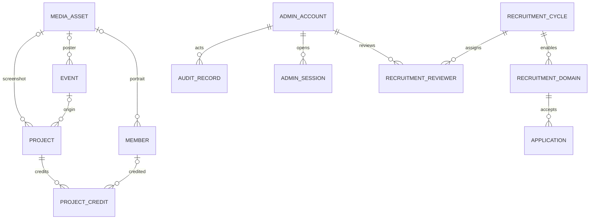

# Code2Chill data model

## Public content

| Record | Stored information |
| --- | --- |
| Member | Name, route slug, public role, optional club domain and biography, display order, and optional portrait. |
| Event | Title, route slug, summary, confirmed calendar date when known, venue, official source page, and optional poster. |
| Project | Title, route slug, summary, optional repository and demo links, originating event, and screenshot. |
| Project credit | Ordered public credit with an optional link to a club member. Contributors can receive credit without appearing on the roster. |
| Media asset | Storage key, content type, alternative text, credit, optional source, and approval for public use. |

New media starts without approval. Missing times and unapproved photographs remain open in the content register. The database types and relationships are defined in the public models. [Content register](CONTENT_REGISTER.md) · [Public models](../backend/app/content_models.py)

## Recruitment

A recruitment cycle has a route, optional opening and closing instants, eligibility text and the domains explicitly enabled for that cycle. A new cycle starts pending with an empty domain list. An application refers to a cycle and a domain together. PostgreSQL checks that the domain belongs to that cycle.

Applications carry the submitted name and university email, optional motivation or portfolio, a review status, a submission attempt identifier and an opaque receipt. These records are private. Local intake verifies the university address using a code tied to the cycle and attempt. The review dashboard is pending. [Recruitment models](../backend/app/recruitment_models.py) · [Launch rules](LAUNCH_SCOPE.md#recruitment)

## Event registration ownership

An event can have an official source page and a confirmed signup destination. The two links serve different purposes. The stored registration state is pending, open, closed, full or ended. A new event defaults to pending.

The university portal owns event submissions and confirmations for launch. Step 5.3 therefore needs fields on Event. A future change in registration ownership would require a separate design for seats, duplicates and confirmation. [Launch registration decision](LAUNCH_SCOPE.md#event-registration)

## Administration

Staff accounts store a normalized email address, Argon2id password hash, role and active flag. Revision `0002` adds a failed sign-in counter and a retry time. Sign-in locks the account row while checking the password and updating these fields. Five consecutive failures pause sign-in for five minutes.

After sign-in, the browser receives a random token in a Secure, HTTP-only, SameSite=Strict cookie. PostgreSQL stores its SHA-256 digest, account, creation time, expiry and revocation time. Each protected request checks the session and the account's current role and active flag. Admins and editors can list saved events. Sign-out revokes the session. [Authentication code](../backend/app/admin_auth.py) · [Staff setup](DEVELOPMENT.md#create-a-staff-account)

The reviewer assignment joins an account to a particular recruitment cycle. The audit table stores the actor, action, typed record identifier, time and optional state changes. A typed identifier keeps an audit entry meaningful after the target record is removed. Deactivate accounts with audit history to retain attribution. Audit writes should store state names and record IDs, with applicant details and secrets kept out of the log. [Administrator models](../backend/app/admin_models.py) · [Administrator journey](PAGES_AND_JOURNEYS.md#administrator-journey)

## Integrity rules

- Public route slugs use lowercase letters, digits, and single hyphens between words. Slugs are unique within each content type. Recruitment cycle slugs follow the same format.
- Primary and foreign keys protect relationships. Removing a project removes its credit rows. Removing a linked roster member keeps the credited name and clears the optional member reference. A used media asset or originating event requires its references to be cleared before deletion.
- PostgreSQL checks required public text, nonnegative display order and credit positions, and approved media descriptions and credits. Storage keys are unique.
- Accounts and applications store trimmed lowercase email addresses. PostgreSQL permits one application per cycle and email, and one row per cycle and attempt identifier. A receipt and a session token digest each have their own unique identifier. The intake API verifies the email code and matches the original attempt and normalized fields before returning a saved receipt.
- Indexes support event date ordering, roster display order, projects by event, scoped applicant filtering, account sessions, and audit lookup by record.

Database constraints act even when records are written outside the HTTP API. [Public models](../backend/app/content_models.py) · [Recruitment models](../backend/app/recruitment_models.py) · [Administrator models](../backend/app/admin_models.py)

## Time handling

Store confirmed campus dates as dates. Leave the time fields empty when the source gives only a date. When the organizer supplies an exact start, store the instant and its corresponding campus date. PostgreSQL checks that the two agree in Asia/Kolkata and that an optional end is after the start.

Application timestamps, session timestamps, registration windows and event instants use PostgreSQL timestamp with time zone. The ORM requires a timezone offset and returns UTC. Use the shared campus conversion for dates and labels in India Standard Time. Windows include their opening instant and exclude their closing instant. A completed recruitment cycle needs both bounds. An external event can carry either confirmed bound. [Time helpers](../backend/app/time_rules.py)

## Publication and state transitions

A member, event, project or recruitment cycle starts in draft. The public copy is a separate snapshot of approved fields created by an explicit publish operation. Its route slug stays stable while published. Saving changes to a draft leaves the last published fields available. A publisher supplies the revision seen in the preview. PostgreSQL locks the record during publication and SQLAlchemy checks its revision. A newer saved revision requires reloading. The helper writes a publication audit entry in the same transaction. Unpublishing removes the snapshot and returns the record to draft.

The publication helper validates the record, checks media approval, and copies fields intended for public use. Future editors must lock the parent and advance its draft revision when saving child collections such as project credits or enabled recruitment domains. Authorization and the API that calls the helper are scheduled for later phases.

Events show ended after their confirmed end or, when only a calendar date is usable, after that campus day. Saved full or closed states take precedence over an open window. Open registration requires the confirmed event-specific Chitkara University destination. A published recruitment cycle requires dates, active reviewer assignment, available domains, eligibility and an approved route. Its public state is scheduled, open or closed according to its window. Without a published cycle the state is announcement. A pending application can be shortlisted, accepted or rejected. A shortlisted application can be accepted or rejected. The accepted and rejected review states are final.

[Publication operations](../backend/app/publication.py) · [Launch rules](LAUNCH_SCOPE.md) · [Administrator journey](PAGES_AND_JOURNEYS.md#administrator-journey)

## Entity relationship diagram

An application reaches its cycle through the composite reference to an enabled domain. Audit targets use a type and record ID, while the administrator who performed the action uses a foreign key. Public snapshots live on the member, event, project and recruitment cycle rows.

## Migrations and initial records

Alembic revision `0001` creates the twelve application tables. The initial seed inserts ten public roster entries, two archived events and two credited projects from the content register. Event times with unresolved evidence stay empty. No recruitment cycle, account or application is created by the seed.

Revision `0003` adds the approved email domain and optional question choice to each cycle. Each email challenge records the cycle, attempt, recipient, digest and sending time. A code expires after 15 minutes. Sending a new code removes expired challenges for that cycle.

The seed inserts records by unique slug inside one transaction. Reruns keep existing rows and preserve both draft edits and previously published copies. An optional `--include-demo` flag inserts a separate, labeled draft event with no booking link. [Setup commands](DEVELOPMENT.md#initialize-the-data-schema) · [Seed implementation](../backend/app/seed.py) · [Content register](CONTENT_REGISTER.md)
