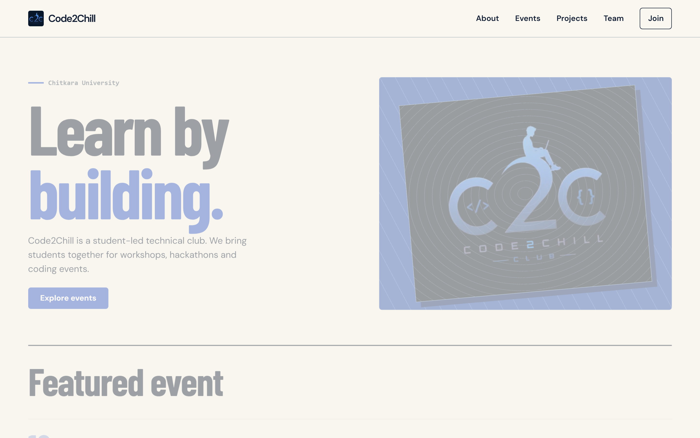
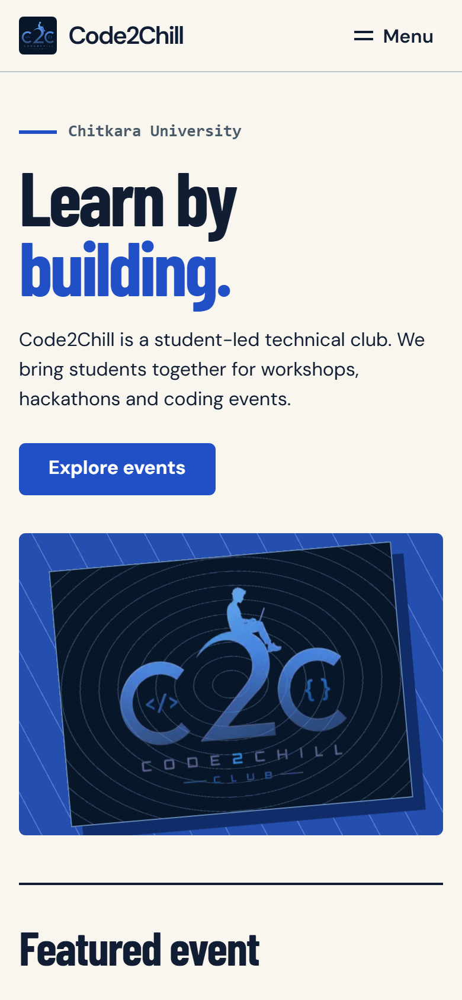
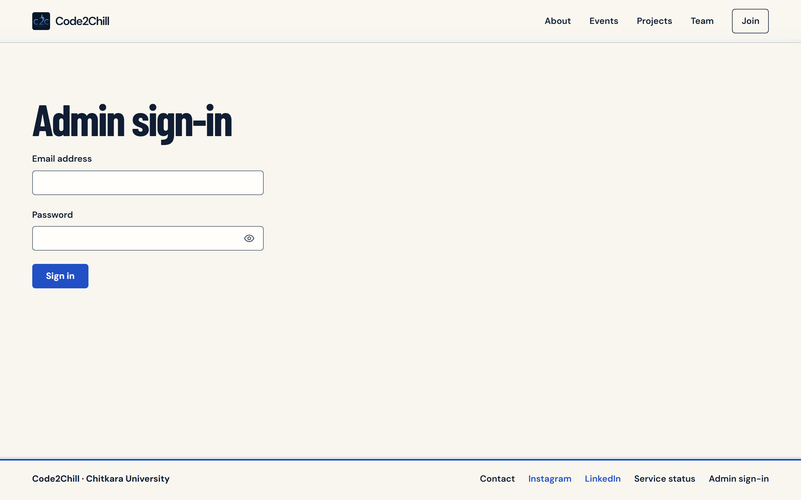
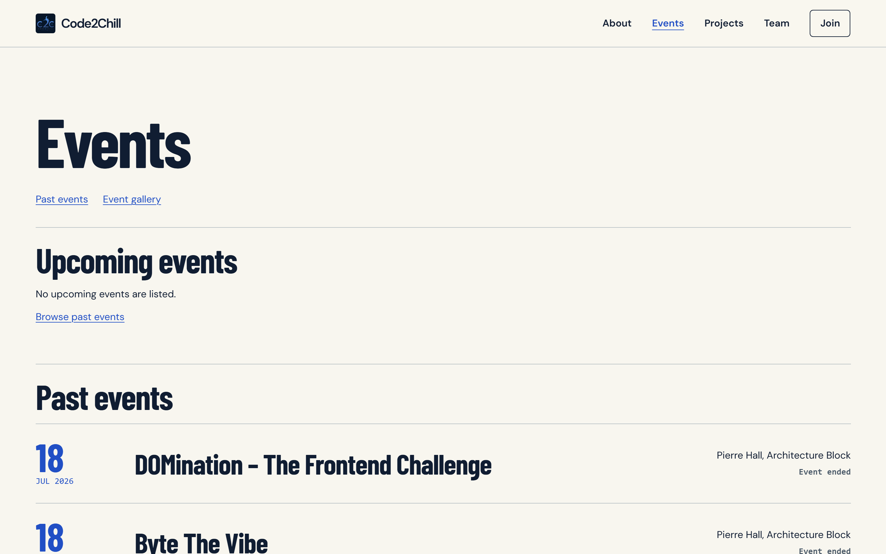
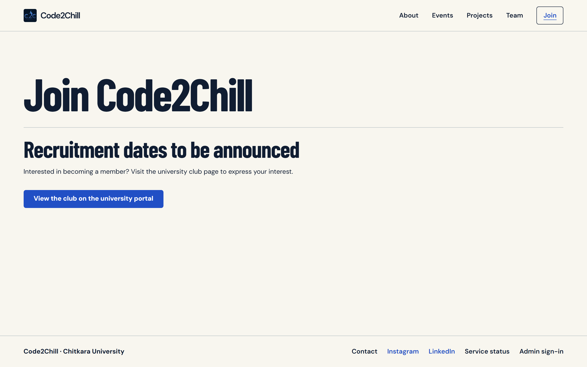
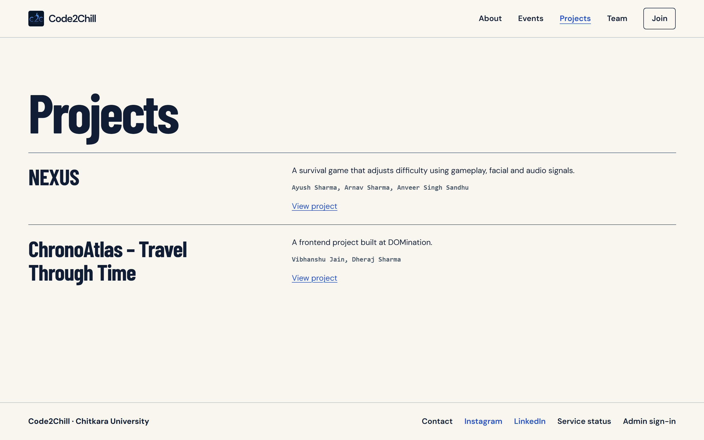
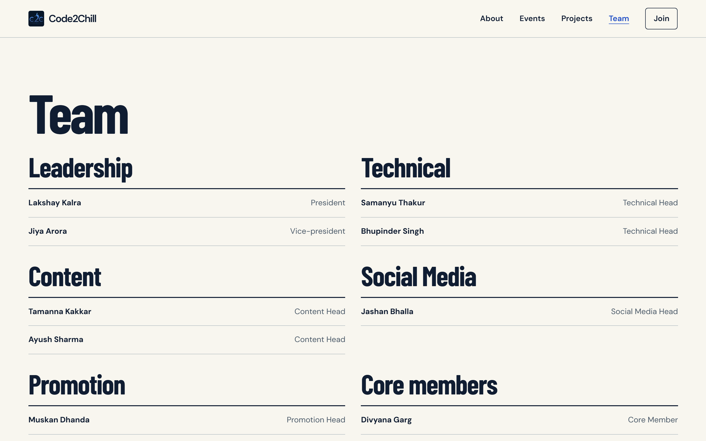
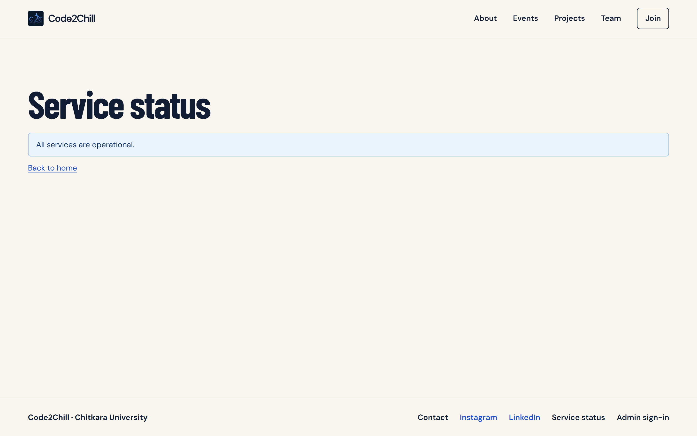

# Code2Chill Demonstration & Walkthrough Guide

This document defines the official 8-step demonstration walkthrough for the Code2Chill platform, accompanying screenshots, talking points, and verification instructions.

---

## 1. Demonstration Sequence & Talking Points

```
1. Homepage (Desktop & Mobile)
   │
2. Admin Sign-in & Authentication
   │
3. Create & Publish Event Draft
   │
4. University Registration Portal Handoff
   │
5. Persistence Across Backend Restart
   │
6. Recruitment Cycle & Application Intake
   │
7. Update Team Leadership & Project Showcase
   │
8. Technical Explanation & Architecture Summary
```

---

### Step 1: Homepage on Desktop and Mobile
- **Action**: Open the homepage at `http://localhost:5173` (or production domain) on desktop (1440 × 900) and phone (390 × 844).
- **Talking Points**:
  - Point out the authentic editorial visual design: warm paper surface (`#f8f6ef`), deep ink typography (`#101d32`), and cyan accent glows.
  - Highlight performance and accessibility: self-hosted fonts (Barlow Condensed, DM Sans), zero third-party font tracking, responsive brand marks (`240w`/`480w` WebP), and zero horizontal overflow.
  - Demonstrate keyboard navigation: Tab to "Skip to content", open phone menu, press Escape to return focus cleanly.
  - Show reduced motion compliance: CSS hardware-accelerated transitions respect `prefers-reduced-motion` without layout disruption.

<p align="center">
  
</p>
<p align="center"><em>Figure 1: Homepage on Desktop Viewport (1440 × 900)</em></p>

<p align="center">
  
</p>
<p align="center"><em>Figure 2: Homepage on Mobile Viewport (390 × 844)</em></p>

---

### Step 2: Administrator Sign-in & Role Security
- **Action**: Navigate to `/admin`. Enter staff credentials and sign in.
- **Talking Points**:
  - Explain password security: passwords are authenticated via Argon2id (`PASSWORD_HASHER`), resistant to GPU-accelerated hash cracking.
  - Explain session management: issues an `HttpOnly`, `SameSite=Lax` cookie storing a cryptographic token, whose SHA-256 digest is stored server-side in PostgreSQL.
  - Explain CSRF protection: all administrative requests automatically attach the custom `X-Code2Chill-Admin: 1` header, preventing cross-origin form submission attacks.

<p align="center">
  
</p>
<p align="center"><em>Figure 3: Secure Staff Authentication Interface</em></p>

---

### Step 3: Event Editorial Flow & Draft Isolation
- **Action**: Open the **Events** workspace. Create a new event draft titled `DOMination 2.0 – Full Stack Hackathon`. Save draft. Preview draft.
- **Talking Points**:
  - Demonstrate **Draft Isolation**: saving a draft stores an editable record in the database, but does NOT modify the live public website. Public visitors continue seeing the existing published schedule.
  - Click **Publish**: backend validates business constraints (e.g. valid event date and HTTPS university registration URL), generates an immutable `public_snapshot` JSONB record, logs an entry in `audit_record`, and commits the transaction.

<p align="center">
  
</p>
<p align="center"><em>Figure 4: Public Events Schedule with Archived & Upcoming Hackathons</em></p>

---

### Step 4: Event Registration & University Portal Handoff
- **Action**: Open the published event detail page. Inspect the registration CTA.
- **Talking Points**:
  - Explain the **University Handoff Architecture**: Code2Chill partners with the university's official portal (`https://chitkarau.life/events/...`) for student event sign-ups.
  - The website evaluates dynamic registration status (`OPEN`, `CLOSED`, `FULL`, `ENDED`) against campus UTC dates on read.
  - If registration closes, the external link is automatically suppressed from the public API response, preventing stale submissions.

---

### Step 5: Persistence Across Backend Restart
- **Action**: In the terminal, restart the backend service (`docker compose restart api` or restart local uvicorn process). Refresh the event page.
- **Talking Points**:
  - The published event, registration link, and audit history persist intact.
  - Relational PostgreSQL data survives container and server restarts through Docker persistent data volumes (`postgres-prod-data`).

---

### Step 6: Recruitment Cycle & Verification Intake
- **Action**: Navigate to `/join`. Show the announcement or open cycle state.
- **Talking Points**:
  - Explain candidate email verification: applicant enters university email, receives a cryptographic code via SMTP.
  - Explain rate limiting and anti-abuse: requests are capped at 32 KiB streaming bytes to prevent memory exhaustion, and codes are invalidated after 5 incorrect attempts.
  - Review dashboard: authorized reviewers can filter applications, record review decisions, and administrators can export records to CSV.

<p align="center">
  
</p>
<p align="center"><em>Figure 5: Student Recruitment & Join Interface</em></p>

---

### Step 7: Team Leadership & Project Showcase
- **Action**: Navigate to `/projects` and `/team`.
- **Talking Points**:
  - Project Showcase: highlights real student achievements from hackathons (e.g., *NEXUS* emotion detection and *ChronoAtlas*), attributing individual team members and linking verified GitHub and live demo URLs.
  - Team Hierarchy: dynamic roster of executive leaders and domain heads (Technical, Content, Social Media, Promotion).
  - Degraded mode protection: if a project screenshot is missing or returns 404, the gallery gracefully displays "Image unavailable" with contributor credits and navigation intact.

<p align="center">
  
</p>
<p align="center"><em>Figure 6: Student Project Showcase (NEXUS, ChronoAtlas)</em></p>

<p align="center">
  
</p>
<p align="center"><em>Figure 7: Official Leadership Roster & Domain Heads</em></p>

---

### Step 8: Operational Health & Infrastructure Summary
- **Action**: Open `/status` in the browser or run `python backend/scripts/health_monitor.py`.
- **Talking Points**:
  - Real-time diagnostic monitoring: probes FastAPI and runs a direct PostgreSQL `SELECT 1` query, measuring round-trip latency in milliseconds.
  - Production readiness: automated Let's Encrypt / ZeroSSL HTTPS via Caddy, automated database backups with SHA-256 verification and 14-day retention, and complete test suites (33 backend pytest cases, 18 browser Playwright tests).

<p align="center">
  
</p>
<p align="center"><em>Figure 8: Real-Time Operational Health Status Monitor</em></p>

---

## 2. Demonstration Rehearsal Checklist

- [x] Local PostgreSQL database running on port 55432 (or Docker container).
- [x] FastAPI backend running on port 8001 (or port 8000).
- [x] React client served via Vite on port 5173 (or Caddy on port 80/443).
- [x] Verified seed records present (10 members, 2 events, 2 projects).
- [x] Staff test account created (`python -m app.create_admin`).
- [x] Browser window preset to 1440 × 900 desktop viewport.
- [x] DevTools device emulation preset to 390 × 844 iPhone viewport.
