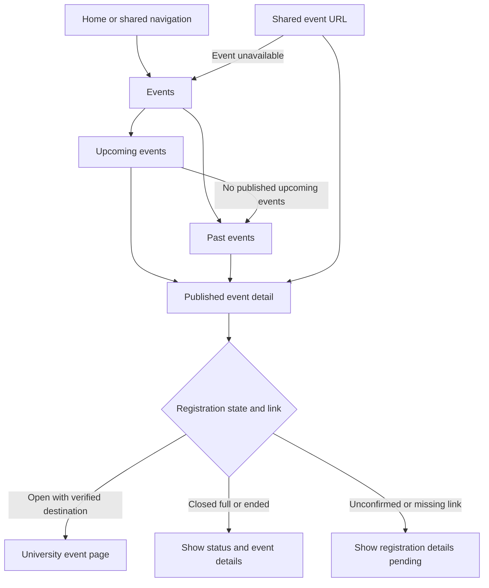
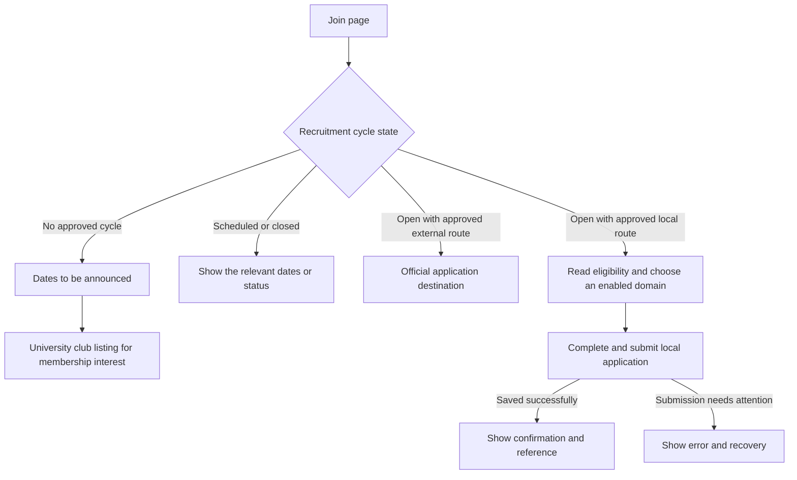
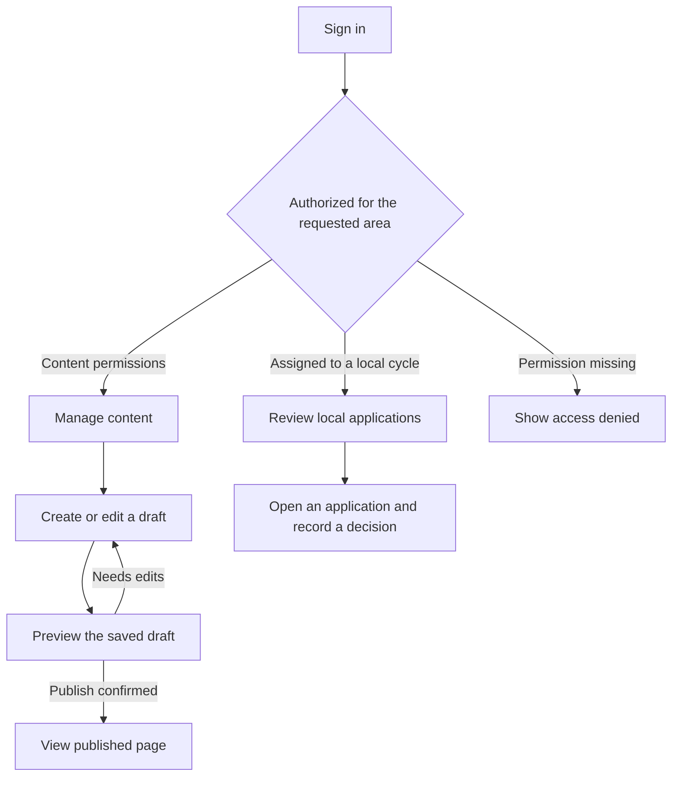

# Code2Chill Pages and User Journeys

This is the website plan. It uses the [first-release scope](LAUNCH_SCOPE.md#first-public-release) and the [verified content register](CONTENT_REGISTER.md).

## Public sitemap

| ID | Page | Path | Purpose |
| --- | --- | --- | --- |
| PUB-01 | Home | `/` | Introduce the club and point students to its activities. |
| PUB-02 | About | `/about` | Explain the club, its university affiliation, and its areas of work. |
| PUB-03 | Events | `/events` | Show upcoming and past events. |
| PUB-04 | Event Detail | `/events/:slug` | Show the published event, its status, and the official sign-up destination when available. |
| PUB-05 | Projects | `/projects` | Present published student projects and their contributors. |
| PUB-06 | Project Detail | `/projects/:slug` | Explain an individual project, credit its contributors, and link to checked resources. |
| PUB-07 | Team | `/team` | Show the approved leadership roster and domain roles. |
| PUB-08 | Join | `/join` | Show the current recruitment state and the official membership interest path. |
| PUB-09 | Contact | `/contact` | Connect visitors with the verified university listing and club social profiles. |

```text
Home /
├── About /about
├── Events /events
│   └── Event Detail /events/:slug
├── Projects /projects
│   └── Project Detail /projects/:slug
├── Team /team
├── Join /join
└── Contact /contact
```

The header logo links to Home. Desktop and mobile navigation provide About, Events, Projects, Team, and Join. Contact stays in the shared footer and is available from About. Detail routes are reachable from their lists and by direct URL. `:slug` stands for the published item's unique URL identifier within its list. Example paths are `/events/byte-the-vibe`, `/events/domination-the-frontend-challenge`, and `/projects/nexus`. An unknown or unpublished item shows a not-found page with a link to its list. An unrecognized top-level path offers a link to Home.

## Event discovery and registration



On `/events`, put Upcoming before Past. Offer section links to `/events#upcoming-events` and `/events#past-events`. An empty upcoming section links to Past. Cards link to published detail pages and show the title, date, and verified venue when available. Use the [two dated event records](CONTENT_REGISTER.md#events-and-projects) for the starting archive.

| Detail case | Student experience |
| --- | --- |
| Open with an organizer-verified destination | **Register on the university portal** opens the official event page in the same tab. The portal owns account prompts, ticket selection, and confirmation. |
| Closed, full, or ended | Show the corresponding status with the event details. **Back to events** returns to Past for ended events and Upcoming for events yet to take place. |
| Open without a verified link, or availability is unknown | Show **Registration details pending**. Provide the event information and the link back to the relevant list section. |
| Event missing or unpublished | Show **Event not found** and offer **Browse events** to `/events`. |
| Request failure | Show an error with **Try again** for the same view and keep public navigation available. |

The [launch registration rules](LAUNCH_SCOPE.md#event-registration) apply across list and detail. Code2Chill displays the organizer-verified state. A student who sees a different outcome on the university site can return with the browser Back action.

## Recruitment journey



| Cycle or submission state | Student experience |
| --- | --- |
| No approved cycle | `/join` shows **Recruitment dates to be announced**. **View the club on the university portal** opens the official listing for general membership interest. |
| Scheduled cycle | Show the enabled domains, eligibility, and opening time in India Standard Time. |
| Open with an approved external route | **Apply through the official form** opens the approved destination. That provider handles the submission and confirmation. |
| Open with an approved local route | **Start application** opens the planned `/join/apply` page. Show eligibility and enabled domains. Collect the name, university email, and domain with the cycle's configured optional prompt. |
| Invalid local submission | Explain the field errors beside the inputs and in a focusable summary. Keep the student's entered values while they correct the form. |
| Local request fails or its result is uncertain | Keep the entered values in the current page and offer **Try again**. The server's duplicate rule prevents a retry from creating another record. |
| Local save confirmed | Show **Application received** and the confirmation reference. Keep applicant details out of the URL. Give the student a link back to Join. |
| Window closes, including while the local form is open | Show **Applications are closed** and return students to Join. The server checks the time again before accepting a submission. |

For a local application, only show duplicate-record details after verifying that the requester controls the university email. The implementation phase will choose how to verify ownership. The [recruitment rules](LAUNCH_SCOPE.md#recruitment) define cycle configuration and time boundaries. A direct visit to `/join/apply` when the local route is unavailable returns the student to the current Join state.

## Administrator journey



| Admin area | Planned path | Purpose |
| --- | --- | --- |
| Sign in | `/admin/sign-in` | Authenticate and continue to the permitted area, defaulting to the dashboard. |
| Dashboard | `/admin` | Find content and the administrative areas the user can access. |
| Content list | `/admin/content/:type` | Find current records and start a draft for events, projects, or team members. |
| Draft creation and editing | `/admin/content/:type/new`, `/admin/content/:type/:id` | Enter content, validate it, save a draft, and make it ready for preview. |
| Protected preview | `/admin/content/:type/:id/preview` | Read the most recently saved draft in public layout before publishing. |
| Site settings and media | `/admin/settings`, `/admin/media` | Manage official links and approved media as those editors are implemented. |
| Local recruitment review | `/admin/recruitment/:cycleId/applications`, `/admin/recruitment/:cycleId/applications/:applicationId` | Let authorized reviewers filter by domain or status and record a permitted decision for the assigned cycle. |

The server verifies authorization for each protected read and change. After authentication, honor a requested return path only if it is an internal admin path the user may access. On session expiry, return to sign in and restore the last saved draft when the user returns. Warn about unsaved changes when the interface can detect them. A signed-in user who lacks the required permission sees **Access denied** with a return to the dashboard.

Saving a draft, previewing it, and publishing it are distinct operations. Public routes keep serving the last published version while someone edits a draft. Opening the preview displays its saved draft and keeps it behind authentication. A publish request validates the required fields and uses the current saved version. If another edit changes that version or the request fails, retain the saved draft and let the editor reload or retry before announcing success. After publishing, offer **View published page**. Event editors can set a verified university sign-up destination and its currently confirmed status.

Use the local review paths only when recruitment uses a local cycle. Signed-in reviewers need an assignment for the requested cycle. Filter lists and open individual submissions only within that authorization. Review actions record the user and time. University event registrations and approved external recruitment follow their own provider workflows.

## Interface states

| ID | Condition | Message or behavior | Available action |
| --- | --- | --- | --- |
| UI-01 | A public list, detail, or dashboard is loading | Keep the heading and navigation stable. Show loading feedback in the content area. | Use the available navigation. |
| UI-02 | A requested view fails to load | Show **This content couldn't load**. Keep the current address and any usable navigation. | **Try again** in the same view. |
| UI-03 | A public page or item is missing | Show **Page not found**, **Event not found**, or **Project not found**. Use the same public item state for an unpublished record. | **Go home**, **Browse events**, or **Browse projects**, respectively. |
| UI-04 | The Upcoming section loaded with zero events | Show **No upcoming events are listed**. | **Browse past events** jumps to Past. |
| UI-05 | The Past section loaded with zero events | Show **No past events are listed**. | **Back to upcoming events** jumps to Upcoming. |
| UI-06 | Projects or Team loaded with zero published records | Show **No projects are published yet** or **Team information is coming soon**. | **Explore events** opens `/events`. |
| UI-07 | Optional approved media is missing or fails to load | Keep the usable text, credits, and links in their normal reading order. | Use any existing verified link. |
| UI-08 | Event registration is open and its destination is verified | Show **Registration open**. | **Register on the university portal**. |
| UI-09 | Event status is unknown or open lacks a verified link | Show **Registration details pending**. | **Back to events**. |
| UI-10 | Event registration is explicitly closed or full | Show **Registration closed** or **Event full**, as applicable. | **Back to events**. |
| UI-11 | The event has ended | Show **Event ended** and keep the archived details. | **Back to events** returns to Past. |
| UI-12 | Recruitment has no approved cycle | Show **Recruitment dates to be announced**. | **View the club on the university portal**. |
| UI-13 | An approved cycle is scheduled or has closed | Show the future opening time in India Standard Time or **Applications are closed**. | Provide the official membership interest link. A local form that closes while open offers **Back to Join**. |
| UI-14 | An approved cycle is open | Show the enabled domains, eligibility, and deadline. | **Apply through the official form** or **Start application**, according to the approved route. |
| UI-15 | A form has actionable validation errors | Show field messages and a focusable summary. Preserve input in the current page. | Correct fields and submit again. |
| UI-16 | A save, publish, or submission is in progress | Give progress feedback and disable duplicate activation of the pending action. | Wait for the result. |
| UI-17 | A write fails, its result is uncertain, or the saved draft version changed | Preserve usable input and the last saved draft. Explain the failure. Confirm saved state before reporting success. | Retry a safe request or **Reload draft** when the saved version changed. |
| UI-18 | A write is confirmed | Display **Draft saved**, **Published**, or **Application received** with an application reference when applicable. | **Preview draft**, **View published page**, or **Back to Join**, respectively. |
| UI-19 | A protected session expires | Ask the user to sign in again. Restore the last saved draft when permitted. | **Sign in**. |
| UI-20 | A signed-in user lacks permission | Show **Access denied** and keep protected content private. | **Back to dashboard**. |
| UI-21 | An administrator list loaded empty | Explain whether there are no records or no results for the active filters. | **New draft** for an empty content list or **Clear filters** when filters are active. An empty application list has a **Back to dashboard** route. |

An initial load error takes priority over an empty result. Only show an empty state after a successful load. For event details, an ended event takes priority over a saved registration state. For other events, use the confirmed full or closed status before evaluating the registration link. Recruitment applies the [configured cycle rules](LAUNCH_SCOPE.md#recruitment) again at submission.

Use visible status text alongside color. Announce progress and confirmed results in a status region and associate field errors with their inputs. Focus the error summary after an invalid submit. Keep keyboard focus available during loading and errors, and make each recovery action usable from the keyboard.
