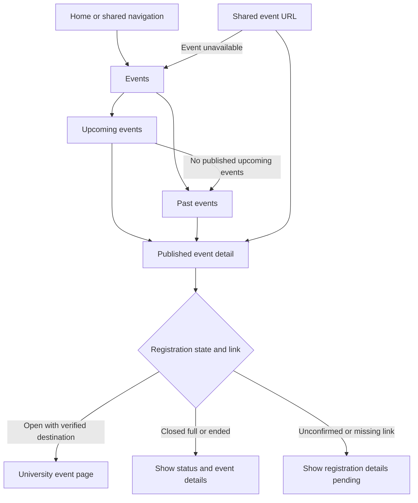

# Code2Chill Pages and User Journeys

This is the website plan. It uses the [first-release scope](LAUNCH_SCOPE.md#first-public-release) and the [verified content register](CONTENT_REGISTER.md).

## Public sitemap

| ID | Page | Path | Purpose |
| --- | --- | --- | --- |
| PUB-01 | Home | `/` | Introduce the club and point students to its activities. |
| PUB-02 | About | `/about` | Explain the club, its university affiliation, and its areas of work. |
| PUB-03 | Events | `/events` | Show upcoming and past events. |
| PUB-04 | Event Detail | `/events/:slug` | Show the published event, its status, and the official sign-up destination when available. |
| PUB-05 | Projects | `/projects` | Present published student projects and their contributors. |
| PUB-06 | Project Detail | `/projects/:slug` | Explain an individual project, credit its contributors, and link to checked resources. |
| PUB-07 | Team | `/team` | Show the approved leadership roster and domain roles. |
| PUB-08 | Join | `/join` | Show the current recruitment state and the official membership interest path. |
| PUB-09 | Contact | `/contact` | Connect visitors with the verified university listing and club social profiles. |

```text
Home /
├── About /about
├── Events /events
│   └── Event Detail /events/:slug
├── Projects /projects
│   └── Project Detail /projects/:slug
├── Team /team
├── Join /join
└── Contact /contact
```

The header logo links to Home. Desktop and mobile navigation provide About, Events, Projects, Team, and Join. Contact stays in the shared footer and is available from About. Detail routes are reachable from their lists and by direct URL. `:slug` stands for the published item's unique URL identifier within its list. Example paths are `/events/byte-the-vibe`, `/events/domination-the-frontend-challenge`, and `/projects/nexus`. An unknown or unpublished item shows a not-found page with a link to its list. An unrecognized top-level path offers a link to Home.

## Event discovery and registration



On `/events`, put Upcoming before Past. Offer section links to `/events#upcoming-events` and `/events#past-events`. An empty upcoming section links to Past. Cards link to published detail pages and show the title, date, and verified venue when available. Use the [two dated event records](CONTENT_REGISTER.md#events-and-projects) for the starting archive.

| Detail case | Student experience |
| --- | --- |
| Open with an organizer-verified destination | **Register on the university portal** opens the official event page in the same tab. The portal owns account prompts, ticket selection, and confirmation. |
| Closed, full, or ended | Show the corresponding status with the event details. **Back to events** returns to Past for ended events and Upcoming for events yet to take place. |
| Open without a verified link, or availability is unknown | Show **Registration details pending**. Provide the event information and the link back to the relevant list section. |
| Event missing or unpublished | Show **Event not found** and offer **Browse events** to `/events`. |
| Request failure | Show an error with **Try again** for the same view and keep public navigation available. |

The [launch registration rules](LAUNCH_SCOPE.md#event-registration) apply across list and detail. Code2Chill displays the organizer-verified state. A student who sees a different outcome on the university site can return with the browser Back action.
